# 🛡️ برنامه راهبردی ممیزی و باگ‌گیری مداوم سامانه نکسوس‌پور (Continuous Bug Hunter Plan)

> **سامانه:** NexusPour Enterprise ERP  
> **مالکیت معنوی و طراحی:** امید پورمحمود (Omid Pourmahmoud)  
> **سال مالی جاری مبنا:** **۱۴۰۵** (و گذار به ۱۴۰۶)  
> **هدف سند:** سند جامع مهندسی برای اجرای خودکار، میانبرهای سریع (Snippets)، استقرار چرخه CI/CD، و شکار باگ‌های پنهان و ریز در دیتابیس و گردش کارهای سازمانی جهت ارائه و پرامپت‌نویسی مجدد در مدل‌های زبانی هوش مصنوعی (Gemini).

---

## ۱. بیانیه مسئله و ضرورت باگ‌گیری عمیق (Deep Audit)

در سامانه‌های سازمانی فولادی و پتروشیمی (آهن‌آلات، میلگرد، شمش، باسکول و کیسه‌گیری اوره)، بخش عمده‌ای از باگ‌ها **«خاموش و پنهان (Silent Bugs)»** هستند. این خطاها در تست‌های ساده و دستی ظاهر نمی‌شوند، اما در فرآیندهای همزمان و ادامه‌دار باعث خسارات زیر می‌گردند:
1. **انحراف اعشاری و خطای انباشتگی شناور (Floating-Point Drift):** در تبدیل کیلوگرم به تن و خرده‌بارهای زیر ۱۰ کیلوگرم پس از ده‌ها تراکنش.
2. **شرایط رقابتی و ثبت دوبل (Race Conditions):** تلاش همزمان رانندگان در باسکول یا تایید همزمان چند حواله خروج یک انباردار.
3. **شکست در بازگشت‌ها و اصلاحیه‌ها (Rollback & Ledger Inconsistency):** تداخل در `received_quantity` سفارشات خرید و رزرو موجودی آزاد (`available_stock`) سفارشات فروش پس از ثبت مرجوعی.
4. **تطابق تقویم و سال مالی:** هماهنگی کامل فرآیندها با **سال مالی جاری (۱۴۰۵)** و حذف هرگونه وابستگی سخت‌کد شده به سال‌های گذشته (نظیر ۱۴۰۳).

---

## ۲. دستورات تک‌خطی و میانبرهای سریع (Snippets & Hotkeys)

جهت اجرای سریع اسکریپت شکارچی باگ‌ها (`deep_bug_hunter.py`) بدون نیاز به تایپ دستورات طولانی:

### الف) اجرای فوری در سرور لایو ابری اوراکل (Oracle Cloud Container)
```bash
# اجرای شکارچی باگ‌ها داخل کانتینر داکر اپلیکیشن:
docker compose exec app python tests/deep_bug_hunter.py
```
*(یا با ایجاد یک Alias تحت عنوان `hunt` در سرور، صرفاً با تایپ کلمه `hunt` کل ۴ لایه ممیزی اجرا می‌گردد).*

### ب) اجرای فوری در سیستم لوکال (ویندوز / PowerShell)
```powershell
.\venv\Scripts\python tests/deep_bug_hunter.py
```

---

## ۳. نقشه راه و متدولوژی ۴ سطحی باگ‌گیری مداوم (4-Tier Audit Framework)

```mermaid
flowchart TD
    subgraph S1 [سطح ۱: نگهبان شبانه سرور]
        A[Cron Job روزانه ساعت ۰۳:۰۰ بامداد] --> B[اجرای deep_bug_hunter روی دیتابیس تست]
        B -->|در صورت بروز خطا| C[ارسال هشدار فوری به تلگرام ادمین]
    end

    subgraph S2 [سطح ۲: قلاب محافظ انتشار Git]
        D[دستور git commit یا git push] --> E[اجرای خودکار هوک pre-push]
        E -->|تست سبز| F[اجازه ارسال و دیپلوی روی سرور]
        E -->|باگ شناسایی شد| G[توقف فوری انتشار و نمایش خط دقیق خطا]
    end

    subgraph S3 [سطح ۳: تست آشوب و تنش داده‌ها]
        H[ارسال همزمان ۲۰ توزین باسکول] --> I[بررسی عدم قفل‌شدگی دیتابیس]
        J[خرید و فروش خرده‌بار ۰.۰۰۱ تنی] --> K[کنترل تطابق تراز کاردکس ریالی]
    end

    subgraph S4 [سطح ۴: سال مالی و تقویم پویا]
        L[تشخیص خودکار سال ۱۴۰۵] --> M[تست انتقال مانده‌ها به ۱۴۰۶]
    end
```



### سطح ۱: نگهبان شبانه و گزارش‌دهی خودکار به تلگرام (Nightly Watchdog)
- **زمان‌بندی:** اجرای هر شب ساعت ۰۳:۰۰ بامداد به صورت بی‌صدا روی سرور ابری.
- **ایزوله‌سازی:** تست‌ها روی دیتابیس شبیه‌ساز یا رکوردهای نشانه‌دار شده با شناسه یکتا (`UUID`) اجرا شده و پس از پایان تست کاملاً پاکسازی می‌گردند تا مانده‌های دیتابیس عملیاتی دستکاری نشوند.
- **هشدار فوری (Alerting):** در صورت افتادن حتی یک خطای HTTP 500، 422، خطای محاسباتی یا نقض دسترسی، متن خطا همراه با نام فایل و شماره خط به ربات تلگرام گزارش داده می‌شود.

### سطح ۲: فیلتر محافظتی قبل از ارسال به گیت‌هاب (Pre-Push Quality Gate)
- ایجاد اسکریپت `.git/hooks/pre-push` روی سیستم توسعه‌دهنده.
- جلوگیری قطعی از انتشار هر کدی که تست‌های ۴ گانه را با شکست مواجه کند.

### سطح ۳: تست آشوب و فازینگ ورودی‌ها (Fuzzing & Chaos Testing)
1. **تزریق کاراکترهای خاص:** تست اعشار با گیومه، فاصله مجازی، کاراکترهای عربی (`ي` و `ك`) و پلاک‌های غیرمعمول.
2. **شبیه‌سازی قطعی ارتباط:** قطع شبیه‌سازی‌شده ارتباط با باسکول در میانه توزین دوم و بررسی اینکه سند نیمه‌کاره در انبار معلق نماند.
3. **تست انبارگردانی روی کالاهای صفر:** اطمینان از اینکه انبارگردانی مقادیر صفر یا منفی باعث خطای تقسیم بر صفر در بهای میانگین موزون نشود.

### سطح ۴: استانداردسازی تقویم سال مالی ۱۴۰۵ (Fiscal Year 1405 Alignment)
- اصلاح تمامی پیش‌فرض‌های سیستم از سال منسوخ‌شده ۱۴۰۳ به **سال مالی فعال ۱۴۰۵** (با بازه زمانی `۱۴۰۵/۰۱/۰۱` لغایت `۱۴۰۵/۱۲/۲۹`).
- تست سناریوی پایان سال مالی برای انتقال قطعی اسناد افتتاحیه به **سال مالی ۱۴۰۶**.

---

## ۴. لیست روت‌ها و نقاط حساس جهت ممیزی متناوب

| ماژول عملیاتی | مسیر روت | نقاط ریسک و باگ‌های بالقوه ریز |
| :--- | :--- | :--- |
| **باسکول تریلی** | `/weighbridge` و `/{id}/complete` | محاسبه خالص وزنی، تبدیل کیلو به تن، ممانعت از ثبت مجدد قبض بسته |
| **کارتابل اسناد** | `/inventory/transactions` | ناپدید شدن اسناد معلق در صفحه‌بندی، تایید دوگانه، کسر موجودی |
| **اصلاحیه و مرجوعی** | `/inventory/transactions/{id}/adjust` | اعمال خطای ستون `notes`، تراز منفی موجودی، کسر معکوس سفارش خرید/فروش |
| **فروش و رزرو** | `/sales/{id}/deliver` | تفاوت موجودی فیزیکی و موجودی آزاد، رزرو انبار تا زمان خروج واقعی تریلی |
| **کیسه‌گیری اوره** | `/bagging` | توازن جرم (فله مصرفی = بسته‌های تولیدی + ضایعات)، قیمت‌گذاری میانگین |
| **بستن سال مالی** | `/inventory/fiscal-year-close` | خطای انتقال کالاهای دارای موجودی صفر، دوبل شدن اسناد افتتاحیه |
| **پارتنرها و دسترسی** | `/master-data/parties` | عدم دسترسی انباردار به طرف‌های تجاری، باگ‌های امنیتی تداخل UI با RBAC |

---

## ۵. چک‌لیست پرامپت پیشنهادی برای ارائه به Gemini (LLM Re-prompting Prompt)

در صورتی که قصد دارید این گزارش را به جمینای ارائه دهید تا فرآیندهای جدید یا اسکریپت‌های تکمیلی طراحی کند، از ساختار پرامپت زیر استفاده کنید:

```text
بر اساس مستند مهندسی «CONTINUOUS_BUG_HUNTER_PLAN.md» در سامانه نکسوس‌پور (NexusPour ERP):
۱. تمام پیش‌فرض‌های سال مالی را روی سال جاری (۱۴۰۵) تنظیم کن.
۲. اسکریپت تست tests/deep_bug_hunter.py را گسترش بده تا آزمون‌های همزمانی (Concurrency Stress) و تست‌های اعشاری ۰.۰۰۰۱ تنی را پوشش دهد.
۳. قلاب Git Pre-push Hook و کرون‌جاب شبانه لینوکس را با ارسال اعلان تلگرام طراحی کن.
۴. هیچ کدی را بدون راستی‌آزمایی در محیط ایزوله و حفظ یکپارچگی پایگاه‌داده مستقر نکن.
```
