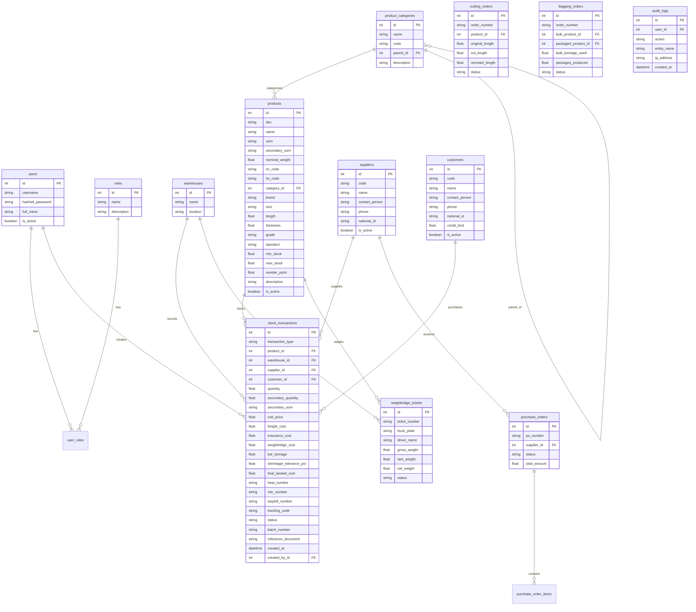

# 🗺️ نقشه جامع و اطلس معماری سامانه نکسوس‌پـور (NexusPour ERP)

> **سند مرجع سریع و راهنمای کامل برای هوش مصنوعی (AI Agents) و توسعه‌دهندگان**  
> این سند برای حفظ دائمی کانتکست، جلوگیری از مصرف بیهوده توکن و دسترسی فوری به تمام جزئیات فنی و ساختاری پروژه تدوین شده است. هر ایجنتی با مطالعه این تک‌فایل، ۱۰۰٪ به وضعیت پروژه مسلط می‌شود.

---

## 📌 ۱. اطلاعات پایه و حقوق مالکیت معنوی (Brand Identity)
* **نام رسمی تجاری:** نکسوس‌پـور | NexusPour ERP
* **نسخه فعال:** Version 2.0.0 (Enterprise Logistics & Storage Edition)
* **مالکیت، طراحی و مهندسی نرم‌افزار:** **امید پورمحمود (Omid Pourmahmoud)**
* **ریپازیتوری گیت‌هاب:** `https://github.com/patronsafety-create/storage_management.git`
* **شاخه اصلی پایدار (Production Branch):** `stable-erp-core`

---

## 🔑 ۲. اطلاعات احراز هویت و دسترسی‌های پیش‌فرض
* **کاربر مدیر کل (Super Admin):**
  * نام کاربری: `admin` | رمز عبور: `1234`
  * دسترسی‌ها: دسترسی نامحدود به تمامی بخش‌ها + منوی مدیریت کاربران، ثبت انبار جدید، ثبت کالای جدید.
* **کاربر اپراتور انبار (Warehouse Operator):**
  * نام کاربری: `operator` | رمز عبور: `operator123`
  * دسترسی‌ها: ثبت اسناد ورود/خروج، انتقال، انبارگردانی، مشاهده کاردکس و موجودی (بدون دسترسی به مدیریت کاربران و تعاریف پایه).
* **کلید امنیتی توکن (SECRET_KEY):** در `.env` ذخیره شده است.
* **الگوریتم رمزنگاری کلمات عبور:** `Argon2id` (بدون تکیه بر passlib به دلیل باگ‌های نسخه جدید).

---

## 🏗️ ۳. استک فنی و معماری نرم‌افزار (Tech Stack)
* **بک‌اند:** Python 3.11 + FastAPI (روترهای تفکیک‌شده در `src/api/`).
* **پایگاه‌داده عملیاتی (Production):** PostgreSQL 15 در کانتینر ایزوله داکر با ولوم پایدار `pgdata`.
* **ORM و مایگریشن:** SQLAlchemy 2.x + Alembic (متصل به Base واحد).
* **فرانت‌اند و UI:** قالب‌های Jinja2 + Bootstrap 5.3 (RTL) + استایل اختصاصی Dark Glassmorphism.
* **تایپوگرافی و بومی‌سازی:** فونت وزیرمتن (Vazirmatn) با فعال‌سازی ویژگی OpenType `font-feature-settings: "ss01" 1` + اسکریپت کلاینت جهت تبدیل ۱۰۰٪ کلیه ارقام و اعداد به فارسی (`۰-۹`).
* **نمودارها:** Chart.js با نمودار کیکی (Doughnut) تحلیلی و جعبه ابزار فارسی.

---

## 🌐 ۴. زیرساخت سرور و استقرار ابری (Oracle Cloud VPS)
* **سرور:** Oracle Cloud Infrastructure (Ubuntu 22.04 LTS - معماری ARM64 Neoverse-N1).
* **مشخصات سرور:** ۴ هسته CPU و ۲۴ گیگابایت رم (بیش از ۲۰ گیگابایت رم و ۳۷ گیگابایت دیسک کاملاً آزاد است).
* **آدرس IP سرور:** `79.76.100.127`
* **مسیر پروژه روی سرور:** `/home/ubuntu/storage_management`
* **سیاست ایزولاسیون:** ۹ ربات تلگرامی کاربر روی سرور فعالند که کاملاً دست‌نخورده باقی مانده‌اند و انبارداری در کانتینرهای مجزای داکر با `restart: always` اجرا می‌شود.
* **پورت‌های کانتینر وب:** پورت `80` و `8000` (اتصال مستقیم به اپلیکیشن).
* **تونل ابری امن:** سرویس سیستم‌دی `storage-tunnel.service` با ابزار Cloudflare Tunnel روی سرور فعال است.

---

## 🗄️ ۵. ساختار جداول پایگاه‌داده (Database Schema)



* **نکته کلیدی مدل‌ها:**
  * جدول `product_categories` ساختار سلسله‌مراتبی و درختی گروه‌های کالایی را پشتیبانی می‌کند.
  * در مدل `Product`، فیلدهای صنعتی و متالورژی (برند، سایز، طول، ضخامت، گرید، استاندارد، IRC، HS Code)، واحد فرعی (`secondary_uom`)، وزن اسمی (`nominal_weight`) و پارامترهای کنترل انبارداری (`min_stock`, `reorder_point`, `max_stock`) اضافه شده‌اند.
  * در مدل `StockTransaction` ستون‌های دو واحدی، بهای تمام‌شده تجمیعی (`freight_cost`, `insurance_cost`, `weighbridge_cost`, `final_landed_cost`)، افت بارنامه، مشخصات متالورژی (`heat_number`, `mtc_number`)، انطباق سامانه تجارت (`waybill_number`, `tracking_code`) و چرخه تأیید (`status`) پیاده‌سازی شده‌اند.
  * مدل‌های تخصصی `Supplier`، `Customer`، `PurchaseOrder`، `WeighbridgeTicket`، `CuttingOrder`، `BaggingOrder` و `AuditLog` به صورت کامل یکپارچه و به دیتابیس متصل شده‌اند.

---

## 🗺️ ۶. نقشه کامل مسیرها و روت‌های سامانه (Endpoints & Pages)

| ردیف | مسیر (Route) | متد | کارکرد و قابلیت | دسترسی |
| :---: | :--- | :---: | :--- | :---: |
| **۱** | `/login` | GET/POST | صفحه ورود و احراز هویت با ظاهر نئونی دارک نکسوس‌پور | عمومی |
| **۲** | `/logout` | GET | خروج از حساب کاربری و باطل‌سازی کوکی سشن | همه کاربران |
| **۳** | `/dashboard` | GET | داشبورد مدیریتی، کارت‌های آمار و نمودار کیکی سهم انبارها | لاگین‌شده |
| **۴** | `/inventory/transaction` | GET/POST | ثبت رسید/حواله دو واحدی با بهای تمام‌شده، هزینه‌های سربار، افت بارنامه و متالورژی | لاگین‌شده |
| **۵** | `/inventory/transactions` | GET | جدول تاریخچه اسناد با امکان تایید/رد سند (Approval Workflow) و مودال دلایل رد | لاگین‌شده |
| **۶** | `/inventory/transactions/{id}/approve` | POST | تایید نهایی سند و اعمال در کاردکس موجودی | مدیر/انباردار |
| **۷** | `/inventory/transactions/{id}/reject` | POST | رد سند با ثبت علت و عدم اعمال در موجودی | مدیر/انباردار |
| **۸** | `/inventory/transactions/{id}/mtc` | GET | **شناسنامه رسمی متالورژی کالا (MTC Certificate):** آنالیز شیمیایی و مکانیکی جهت چاپ | لاگین‌شده |
| **۹** | `/inventory/products/{id}/label` | GET | **چاپ لیبل بارکد و QR Code استاندارد ۱۰۰x۷۰ میلی‌متر** با خطوط برش | لاگین‌شده |
| **۱۰** | `/inventory/transfer` | GET/POST | **انتقال بین انبارها:** کسر از انبار مبدأ و افزودن به مقصد با مرجع واحد | لاگین‌شده |
| **۱۱** | `/inventory/stocktaking` | GET/POST | **انبارگردانی:** مقایسه شمارش عینی با سیستم و صدور سند خودکار تعدیل | لاگین‌شده |
| **۱۲** | `/inventory/returns/new` | GET/POST | **اسناد برگشت از خرید و برگشت از فروش:** اتصال به سند مرجع و برگشت موجودی | لاگین‌شده |
| **۱۳** | `/inventory/balance` | GET | گزارش تفصیلی موجودی لحظه‌ای (مقداری، دو واحدی و ریالی) | لاگین‌شده |
| **۱۴** | `/inventory/alerts` | GET | **مرکز هشدارهای هوشمند انبار:** کالاهای زیر نقطه سفارش و کالاهای راکد (+۹۰ روز) | لاگین‌شده |
| **۱۵** | `/inventory/alerts/badge` | GET | وب‌سرویس تعداد هشدارهای فعال جهت نمایش زنده روی آیکون زنگوله نوبار | لاگین‌شده |
| **۱۶** | `/purchases` | GET | **مدیریت سفارشات خرید (PO):** لیست، فیلترها و شاخص‌های مالی سفارشات | لاگین‌شده |
| **۱۷** | `/purchases/new` | GET/POST | فرم ثبت سفارش خرید جدید با اقلام چندگانه | لاگین‌شده |
| **۱۸** | `/purchases/{id}` | GET | مشاهده جزئیات سفارش خرید و دکمه تبدیل با ۱ کلیک به رسید انبار | لاگین‌شده |
| **۱۹** | `/purchases/{id}/receive` | POST | **تبدیل هوشمند سفارش خرید به رسید انبار:** ثبت رسید و بستن خودکار PO | لاگین‌شده |
| **۲۰** | `/weighbridge` | GET | **زیرسیستم باسکول تریلی:** لیست نوبت‌ها، وضعیت توزین، ترافیک و مغایرت وزن | لاگین‌شده |
| **۲۱** | `/weighbridge/new` | GET/POST | ثبت توزین اول تریلی (پر یا خالی) و بررسی سقف تناژ پلیس‌راه | لاگین‌شده |
| **۲۲** | `/weighbridge/{id}/second` | GET | فرم ثبت توزین مرحله دوم | لاگین‌شده |
| **۲۳** | `/weighbridge/{id}/complete` | POST | ثبت توزین دوم، محاسبه خالص و صدور مستقیم سند انبار | لاگین‌شده |
| **۲۴** | `/weighbridge/{id}/print` | GET | **برگه رسمی قبض باسکول دیجیتال:** فرمت استاندارد پرینت با بارکد و پلاک | لاگین‌شده |
| **۲۵** | `/cutting` | GET | **مدیریت دستورات برش و انبار ته‌شاخه آهن:** محاسبه بهای تمام‌شده ته‌شاخه | لاگین‌شده |
| **۲۶** | `/cutting/new` | GET/POST | ثبت دستور برش جدید و انتقال خودکار ته‌شاخه به انبار ضایعات/ته‌شاخه | لاگین‌شده |
| **۲۷** | `/bagging` | GET | **زیرسیستم کیسه‌گیری فله به جامبوبگ اوره:** مانیتورینگ ضریب مصرف و ریزش | لاگین‌شده |
| **۲۸** | `/bagging/new` | GET/POST | ثبت عملیات کیسه‌گیری فله و محاسبه هزینه دستمزد و بسته‌بندی | لاگین‌شده |
| **۲۹** | `/compliance` | GET | **داشبورد انطباق با سامانه‌های دولتی:** مانیتورینگ کدهای IRC، بارنامه برخط و سامانه تجارت | لاگین‌شده |
| **۳۰** | `/compliance/export/ntsw` | GET | **دانلود خروجی اکسل ویژه سامانه جامع تجارت (ntsw.ir):** با کدگذاری UTF-8 BOM | لاگین‌شده |
| **۳۱** | `/admin/audit-logs` | GET | **لاگ جامع حسابرسی و ردپای امنیتی:** گزارش رویدادها، تغییرات اسناد و IP کاربران | ادمین |
| **۳۲** | `/master-data/products` | GET | **کاتالوگ جامع کالاها:** مشخصات متالورژی، موجودی لحظه‌ای، فیلتر و چاپ لیبل | لاگین‌شده |
| **۳۳** | `/master-data/product` | POST | ثبت کالای جدید با کدینگ SKU و ویژگی‌های فنی | ادمین |
| **۳۴** | `/master-data/product/{id}/edit` | POST | ویرایش مشخصات و پارامترهای کنترل موجودی کالا | ادمین |
| **۳۵** | `/master-data/parties` | GET/POST | **مدیریت طرف‌های تجاری:** ثبت و ویرایش تأمین‌کنندگان و مشتریان با اعتبارسنجی ملی و فیلتر وضعیت | لاگین‌شده |
| **۳۶** | `/master-data/supplier/{id}/delete` | POST | **حذف قطعی تأمین‌کننده:** با اعتبارسنجی عدم وجود اسناد انبار/باسکول جهت حفظ یکپارچگی دفاتر | ادمین |
| **۳۷** | `/master-data/customer/{id}/delete` | POST | **حذف قطعی مشتری:** با اعتبارسنجی عدم وجود اسناد حواله/باسکول | ادمین |
| **۳۸** | `/guide` | GET | **کاتالوگ فنی و راهنمای جامع تعاملی نکسوس‌پور در وب:** به همراه دکمه‌های دانلود PDF | لاگین‌شده |
| **۳۹** | `/static/docs/nexus_pour_user_manual.pdf` | GET | **دانلود دفترچه راهنمای جامع ۱۰ صفحه‌ای (PDF):** کیفیت وکتور چاپی و واترمارک رسمی | عمومی/لاگین |
| **۴۰** | `/static/docs/nexus_pour_executive_presentation.pdf` | GET | **دانلود پرزنتیشن مدیریتی ۳ صفحه‌ای (PDF):** گزارش راهبردی ویژه مدیران با توجیه ROI | عمومی/لاگین |
| **۴۱** | `/admin/users` | GET/POST | پنل مدیریت کاربران، ایجاد کاربر جدید و تخصیص نقش | ادمین |
| **۴۲** | `/api/stock-check` | GET | وب‌سرویس AJAX برای بررسی موجودی آنی کالا در انبار انتخابی | لاگین‌شده |

---

## 🛡️ ۷. قابلیت‌های کلیدی زیرساختی و امنیتی (Enterprise Capabilities)
1. **استقرار ۱۰۰٪ لوکال و آفلاین (On-Premises / Air-Gapped Ready):**
   * تمامی داده‌ها روی پایگاه‌داده PostgreSQL داخل کانتینر اختصاصی داکر ذخیره می‌شوند.
   * بدون هیچ‌گونه نیاز به اینترنت خارجی یا ابزارهای تلمتری شخص ثالث، برنامه می‌تواند در شبکه محلی (LAN) شرکت، پشت فایروال سازمان اجرا شود.
2. **انطباق با استانداردهای کشور ترکیه (Turkey Regionalization Architecture):**
   * معماری داده‌ها آماده ترجمه کامل به زبان ترکی استانبولی (`tr-TR`).
   * ساختار ثبت بارنامه‌ها و فاکتورها قابلیت تطبیق با استانداردهای **`e-İrsaliye`** و **`e-Fatura`** اداره درآمد ترکیه (GİB) را داراست.
   * پشتیبانی از کدهای گمرکی بین‌المللی **GTİP / HS Code** و واحدهای استاندارد **TSE**.
3. **تقویم تعاملی دوگانه (Dual Jalali & Gregorian DatePicker):**
   * تعبیه شده در `templates/base.html` با شناسه `#jalaliDatePickerModal`.
   * تبدیل زنده و دوطرفه تاریخ‌های شمسی و میلادی، تشخیص خودکار فرمت ورودی‌ها، دکمه‌های امروز و پاک‌کردن، و پالت نئونی هماهنگ با طراحی دارک.
4. **موتور تولید PDF برداری شرکتی (Headless Chromium Engine):**
   * تولید خودکار PDF‌های چاپی و وکتور از روی کدهای HTML/CSS با مرورگر کروم هدلس.
   * دارای استایل‌های اختصاصی `@page`، واترمارک مورب، لوگوی وکتور، هدر و فوتر استاندارد با شماره صفحه خودکار.

---

## 💡 ۸. راهنمای سریع عیب‌یابی و یادداشت‌های توسعه بعدی برای هوش مصنوعی (AI Fast Recovery & Debugging Cheatsheet)

> **توجه برای ایجنت‌های بعدی:** در صورت برخورد با هرگونه باگ یا نیاز به افزودن ویژگی‌های جدید، به این چک‌لیست طلایی مراجعه کنید:

1. **لودینگ مودال‌های بوت‌استرپ و DatePicker:**
   * هرگز مودال‌های بوت‌استرپ را داخل کانتینرهای دارای کلاس‌های CSS با `transform` یا `filter` قرار ندهید (زیرا باعث گیر کردن بک‌دراپ تیره روی صفحه می‌شود). مودال تقویم در انتهای `templates/base.html` مستقر است.
2. **بررسی خطای حذف طرف‌های تجاری (IntegrityError):**
   * در روت‌های `delete_supplier` و `delete_customer` در `src/api/parties_ui.py`، همواره قبل از `db.delete()` جداول `StockTransaction`، `PurchaseOrder` و `WeighbridgeTicket` بررسی می‌شوند. در صورت وجود وابستگی، خطا با پیام فارسی ریدایرکت می‌شود.
3. **مایگریشن‌های دیتابیس در `src/api/main.py`:**
   * در متد `lifespan` اپلیکیشن، بلاک `ALTER TABLE ... ADD COLUMN IF NOT EXISTS` برای سازگاری عقب‌رو قرار داده شده است. اگر ستون جدیدی به مدل‌ها اضافه کردید، حتماً یک خط `ADD COLUMN IF NOT EXISTS` به این بلاک اضافه کنید تا سرور داکر بدون نیاز به اجرای دستی اسکریپت به‌روز شود.
4. **پوشه فایل‌های استاتیک و PDF:**
   * پوشه `static/docs/` حاوی فایل‌های راهنما و پرزنتیشن است. اگر فایل PDF جدیدی تولید کردید، هم در ریشه پروژه و هم در `static/docs/` ذخیره کنید تا روت استاتیک FastAPI آن را تحویل دهد.
5. **ارقام فارسی و تبدیل اعداد:**
   * برای جلوگیری از خطای دیتابیس در فیلدهای عددی، از تابع کمکی `to_english_digits()` در پایتون یا `toEnglishDigits()` در جاوااسکریپت استفاده کنید تا ارقام فارسی `۰-۹` به اعداد انگلیسی تبدیل شوند.
6. **سیاست سرور اوراکل (`79.76.100.127`):**
   * فقط و فقط دایرکتوری `/home/ubuntu/storage_management` را لمس کنید. ۹ ربات تلگرامی در سایر پوشه‌ها فعالند. بعد از `git pull` روی سرور، کافیست دستور `sudo docker compose restart app` اجرا شود.

---

## 🚀 ۹. نقشه راه بومی‌سازی ترکیه و توسعه آتی (Turkey Localization & Next Steps)
* **سند مرجع جامع ترکیه:** تمامی جزئیات، پارت‌بندی و چک‌لیست استانداردهای ترکیه در فایل [TURKEY_LOCALIZATION_ROADMAP.md](file:///c:/Users/opour/storage_management/TURKEY_LOCALIZATION_ROADMAP.md) مستند و در حال پیاده‌سازی فاز به فاز است.
1. **پارت‌های بومی‌سازی ترکیه (Türkiye Edition):**
   * پارت ۱: زیرساخت دو‌منطقه‌ای، چندزبانه و صفحه ورود
   * پارت ۲: طرف‌های تجاری و شناسه‌های هویتی ترکیه (VKN, T.C. Kimlik, MERSİS)
   * پارت ۳: کدینگ کالا و استانداردهای صنعتی و گمرکی (GTİP, TSE, TS 708)
   * پارت ۴: موتور مالیات، عوارض و توقیف مالیات آهن‌آلات (KDV & Demir-Çelik Tevkifatı)
   * پارت ۵: باسکول کانتار و پلاک خودرو ترکیه (Kantar Fişi, KGM)
   * پارت ۶: بارنامه الکترونیک و رهگیری ترابری (e-İrsaliye, U-ETDS)
   * پارت ۷: اسناد رسمی و خروجی‌های مدیریتی دوزبانه
2. **اسکنر بارکد و QR Code با دوربین موبایل/وب‌کم (WebRTC In-Browser Barcode Scanner):**
   * افزودن کتابخانه جاوااسکریپت `html5-qrcode` جهت اسکن سریع بارکد کالاها در فرم‌های ورود و خروج بدون نیاز به هندلرهای سخت‌افزاری گران‌قیمت.
3. **اسکریپت بکاپ‌گیری خودکار روزانه از دیتابیس PostgreSQL (Automated DB Backup Cron):**
   * نوشتن یک کرون‌جاب لینوکسی داخل سرور که هر شب ساعت ۱۲ از دیتابیس `pg_dump` تهیه کرده و در پوشه `backups/` با تاریخ شمسی ذخیره نماید.
4. **سیستم پیش‌بینی موجودی و تحلیل فصلی با هوش مصنوعی (Inventory Forecasting):**
   * اضافه کردن الگوریتم تخمین اتمام موجودی بر اساس میانگین مصرف ۳۰ روز گذشته (Runway Days) برای مقاطع پرمصرف فولادی.

---

## ⚡ ۱۰. دستورات سریع راه‌اندازی و دیپلوی (Quick Commands)
```powershell
# کامپایل و بررسی تمپلیت‌ها
python -c "import jinja2; env = jinja2.Environment(loader=jinja2.FileSystemLoader('templates')); [env.get_template(t) for t in os.listdir('templates') if t.endswith('.html')]; print('Templates OK')"

# ارسال تغییرات به گیت‌هاب
git add -A
git commit -m "update: commit message"
git push origin stable-erp-core

# به‌روزرسانی سرور اوراکل با SSH
ssh oracle "cd /home/ubuntu/storage_management && git pull origin stable-erp-core && sudo docker compose restart app"
```

