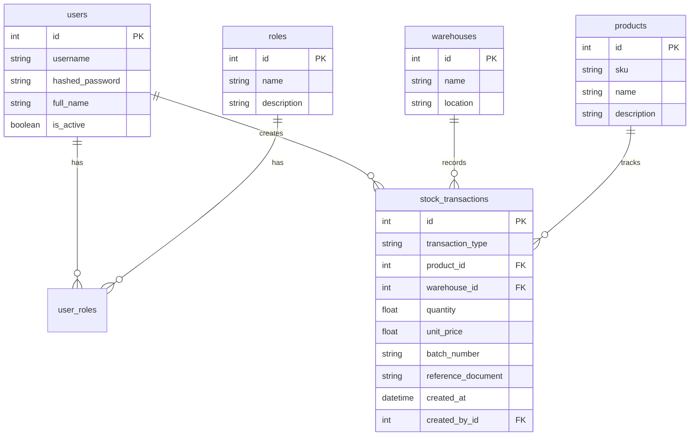

# 🗺️ نقشه جامع و اطلس معماری سامانه نکسوس‌پـور (NexusPour ERP)

> **سند مرجع سریع و راهنمای کامل برای هوش مصنوعی (AI Agents) و توسعه‌دهندگان**  
> این سند برای حفظ دائمی کانتکست، جلوگیری از مصرف بیهوده توکن و دسترسی فوری به تمام جزئیات فنی و ساختاری پروژه تدوین شده است. هر ایجنتی با مطالعه این تک‌فایل، ۱۰۰٪ به وضعیت پروژه مسلط می‌شود.

---

## 📌 ۱. اطلاعات پایه و حقوق مالکیت معنوی (Brand Identity)
* **نام رسمی تجاری:** نکسوس‌پـور | NexusPour ERP
* **نسخه فعال:** Version 2.0.0 (Enterprise Logistics & Storage Edition)
* **مالکیت، طراحی و مهندسی نرم‌افزار:** **امید پورمحمود (Omid Pourmahmoud)**
* **ریپازیتوری گیت‌هاب:** `https://github.com/patronsafety-create/storage_management.git`
* **شاخه اصلی پایدار (Production Branch):** `stable-erp-core`

---

## 🔑 ۲. اطلاعات احراز هویت و دسترسی‌های پیش‌فرض
* **کاربر مدیر کل (Super Admin):**
  * نام کاربری: `admin` | رمز عبور: `1234`
  * دسترسی‌ها: دسترسی نامحدود به تمامی بخش‌ها + منوی مدیریت کاربران، ثبت انبار جدید، ثبت کالای جدید.
* **کاربر اپراتور انبار (Warehouse Operator):**
  * نام کاربری: `operator` | رمز عبور: `operator123`
  * دسترسی‌ها: ثبت اسناد ورود/خروج، انتقال، انبارگردانی، مشاهده کاردکس و موجودی (بدون دسترسی به مدیریت کاربران و تعاریف پایه).
* **کلید امنیتی توکن (SECRET_KEY):** در `.env` ذخیره شده است.
* **الگوریتم رمزنگاری کلمات عبور:** `Argon2id` (بدون تکیه بر passlib به دلیل باگ‌های نسخه جدید).

---

## 🏗️ ۳. استک فنی و معماری نرم‌افزار (Tech Stack)
* **بک‌اند:** Python 3.11 + FastAPI (روترهای تفکیک‌شده در `src/api/`).
* **پایگاه‌داده عملیاتی (Production):** PostgreSQL 15 در کانتینر ایزوله داکر با ولوم پایدار `pgdata`.
* **ORM و مایگریشن:** SQLAlchemy 2.x + Alembic (متصل به Base واحد).
* **فرانت‌اند و UI:** قالب‌های Jinja2 + Bootstrap 5.3 (RTL) + استایل اختصاصی Dark Glassmorphism.
* **تایپوگرافی و بومی‌سازی:** فونت وزیرمتن (Vazirmatn) با فعال‌سازی ویژگی OpenType `font-feature-settings: "ss01" 1` + اسکریپت کلاینت جهت تبدیل ۱۰۰٪ کلیه ارقام و اعداد به فارسی (`۰-۹`).
* **نمودارها:** Chart.js با نمودار کیکی (Doughnut) تحلیلی و جعبه ابزار فارسی.

---

## 🌐 ۴. زیرساخت سرور و استقرار ابری (Oracle Cloud VPS)
* **سرور:** Oracle Cloud Infrastructure (Ubuntu 22.04 LTS - معماری ARM64 Neoverse-N1).
* **مشخصات سرور:** ۴ هسته CPU و ۲۴ گیگابایت رم (بیش از ۲۰ گیگابایت رم و ۳۷ گیگابایت دیسک کاملاً آزاد است).
* **آدرس IP سرور:** `79.76.100.127`
* **مسیر پروژه روی سرور:** `/home/ubuntu/storage_management`
* **سیاست ایزولاسیون:** ۹ ربات تلگرامی کاربر روی سرور فعالند که کاملاً دست‌نخورده باقی مانده‌اند و انبارداری در کانتینرهای مجزای داکر با `restart: always` اجرا می‌شود.
* **پورت‌های کانتینر وب:** پورت `80` و `8000` (اتصال مستقیم به اپلیکیشن).
* **تونل ابری امن:** سرویس سیستم‌دی `storage-tunnel.service` با ابزار Cloudflare Tunnel روی سرور فعال است.

---

## 🗄️ ۵. ساختار جداول پایگاه‌داده (Database Schema)



* **نکته کلیدی مدل‌ها:**
  * در مدل `StockTransaction` (فایل `src/domain_model/inventory_models.py`)، ستون‌های `unit_price` (برای کاردکس ریالی) و `created_by_id` (برای ردیابی کاربر ثبت‌کننده) اضافه شده‌اند.
  * رابطه با کاربر ثبت‌کننده با نام `created_by` تعریف شده است.

---

## 🗺️ ۶. نقشه کامل مسیرها و روت‌های سامانه (Endpoints & Pages)

| ردیف | مسیر (Route) | متد | کارکرد و قابلیت | دسترسی |
| :---: | :--- | :---: | :--- | :---: |
| **۱** | `/login` | GET/POST | صفحه ورود و احراز هویت با ظاهر نئونی دارک نکسوس‌پور | عمومی |
| **۲** | `/logout` | GET | خروج از حساب کاربری و باطل‌سازی کوکی سشن | همه کاربران |
| **۳** | `/dashboard` | GET | داشبورد مدیریتی، کارت‌های آمار و نمودار کیکی سهم انبارها | لاگین‌شده |
| **۴** | `/inventory/transaction` | GET/POST | فرم ثبت رسید (ورود) و حواله (خروج) کالا با بررسی لحظه‌ای موجودی | لاگین‌شده |
| **۵** | `/inventory/transfer` | GET/POST | **انتقال بین انبارها:** کسر از انبار مبدأ و افزودن به مقصد با مرجع واحد | لاگین‌شده |
| **۶** | `/inventory/stocktaking` | GET/POST | **انبارگردانی:** مقایسه شمارش عینی با سیستم و صدور سند خودکار تعدیل | لاگین‌شده |
| **۷** | `/inventory/balance` | GET | گزارش تفصیلی موجودی لحظه‌ای هر کالا در هر انبار | لاگین‌شده |
| **۸** | `/inventory/transactions` | GET | جدول جامع تاریخچه اسناد با امکان جستجو و فیلتر | لاگین‌شده |
| **۹** | `/inventory/kardex/{product_id}` | GET | کاردکس مقداری کالا با مانده لحظه‌ای سطر به سطر | لاگین‌شده |
| **۱۰** | `/inventory/financial-kardex/{id}` | GET | **کاردکس ریالی:** ارزش‌گذاری موجودی با الگوریتم میانگین موزون | لاگین‌شده |
| **۱۱** | `/inventory/transaction/{id}/print` | GET | **برگه رسمی A4 سند انبار:** فرمت استاندارد پرینت با ۴ امضای تایید | لاگین‌شده |
| **۱۲** | `/inventory/export/stock` | GET | دانلود خروجی اکسل/CSV موجودی کالاها با فونت و کدگذاری UTF-8 | لاگین‌شده |
| **۱۳** | `/inventory/export/transactions` | GET | دانلود خروجی اکسل/CSV تاریخچه کامل تراکنش‌ها | لاگین‌شده |
| **۱۴** | `/admin/users` | GET/POST | پنل مدیریت کاربران، ایجاد کاربر جدید و تخصیص نقش | ادمین |
| **۱۵** | `/master-data/products` | POST | ثبت کالای جدید در سیستم | ادمین |
| **۱۶** | `/master-data/warehouses` | POST | ثبت انبار جدید در سیستم | ادمین |
| **۱۷** | `/api/stock-check` | GET | وب‌سرویس AJAX برای بررسی موجودی آنی کالا در انبار انتخابی | لاگین‌شده |

---

## 💡 ۷. تجربیات حل باگ و نکات کلیدی برای ایجنت‌های بعدی (Gotchas)
1. **لودینگ مودال‌های بوت‌استرپ:** مودال‌ها نباید داخل تگ‌های دارای `transform` یا انیمیشن CSS قرار گیرند؛ در `base.html` یک بلاک اختصاصی به نام `` خارج از کانتینر اصلی قرار داده شده است.
2. **ارتباطات SQLAlchemy:** در کلاس `StockTransaction` از تعریف متغیر مترادف بدون `synonym` خودداری شود؛ رابطه `created_by = relationship("User", foreign_keys=[created_by_id])` تعریف شده است.
3. **پوشه static:** در فایل `src/api/main.py` قبل از مانت کردن پوشه استاتیک، `os.makedirs("static", exist_ok=True)` قرار گرفته تا در سرورهای کلود بدون پوشه خالی به خطا نخورد.
4. **اعداد فارسی:** فونت وزیرمتن با ویژگی `font-feature-settings: "ss01" 1` فعال است و اسکریپت `toPersianDigits` در DOM متون را به فارسی برمی‌گرداند.

---

## ⚡ ۸. دستورات سریع راه‌اندازی (Quick Commands)
```powershell
# اجرای لوکال در ویندوز با داکر
docker compose up -d

# مشاهده لاگ کانتینر برنامه
docker compose logs app -f

# بررسی وضعیت سرور اوراکل از طریق SSH
ssh oracle "cd /home/ubuntu/storage_management && docker compose ps"
```
