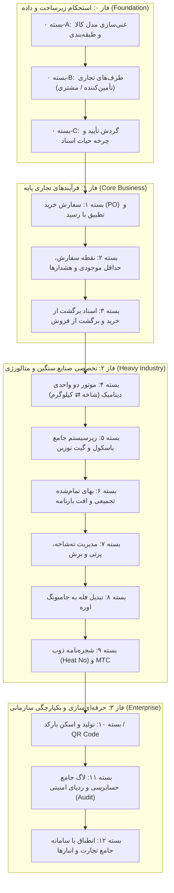

# 🚀 نقشه راه جامع توسعه سامانه نکسوس‌پـور (NexusPour ERP & Heavy WMS Roadmap)

> **سند بالادستی و استراتژیک توسعه نرم‌افزار انبارداری جامع و صنایع سنگین (فولاد، متالورژی، پتروشیمی و کالاهای تجاری)**  
> **صاحب امتیاز، طراح و مدیر محصول:** امید پورمحمود (Omid Pourmahmoud)  
> **نسخه نقشه راه:** 2.1.0 (بازبینی و ارتقا به ۱۲ بسته بر پایه تحلیل شکاف رقابتی با سپیدار، راهکاران و SAP EWM)  
> **دامنه کاربرد:** انبارداری عمومی، مقداری و ریالی، آهن‌آلات، میلگرد، تیرآهن، شمش فولادی (Billet)، لوله و ورق، اوره فله و بسته‌بندی جامبوبگ

---

## 🎯 مرجع دائمی نشست‌ها (Zero-Loss Context Guarantee)
این سند به همراه [PROJECT_MAP.md](file:///c:/Users/opour/storage_management/PROJECT_MAP.md) و [AGENTS.md](file:///c:/Users/opour/storage_management/AGENTS.md) طراحی شده تا در هر نشستی، پس از ریست سهمیه، قطع ارتباط، پاکسازی کانتکست یا تغییر مدل هوش مصنوعی، ایجنت یا توسعه‌دهنده بعدی با خواندن این سند دقیقاً بداند:
1. چه امکاناتی تاکنون پیاده‌سازی شده و پایدار هستند (هسته ۱۷ قابلیته فعلی).
2. ساختار ۱۲ بسته‌ای ارتقایافته چیست و چرا چیده شده است.
3. در گام فعلی دقیقاً کدام بسته باید پیاده‌سازی شود و نیازی به بازرسی تکراری کل مخزن کد نباشد.

---

## 🏗️ ساختار فازها و معماری ۱۲ بسته‌ای نکسوس‌پـور

---

## 📋 شرح تفصیلی بسته‌های توسعه

### 🧩 فاز ۰: استحکام زیرساخت و مدل داده (Foundation & Data Architecture)

#### 📦 بسته ۰-A: غنی‌سازی مدل کالا و طبقه‌بندی درختی (Product Enrichment & Categorization)
* **ضرورت و تحلیل رقابتی:** در حال حاضر مدل کالا صرفاً شامل `name` و `uom` است. در سیستم‌های صنعتی و ERP، کالا دارای کدینگ، مشخصات ابعادی، برند، استاندارد و پارامترهای کنترل موجودی است.
* **ویژگی‌های ماژول:**
  1. جدول `ProductCategory`: دسته‌بندی درختی/سلسله‌مراتبی کالاها (مانند: مقاطع فولادی > میلگرد > میلگرد آجدار).
  2. فیلدهای کلیدی در `Product`:
     * کد شناسایی کالا (`sku` / بارکد سیستمی یکتا).
     * کلید خارجی دسته‌بندی (`category_id`).
     * مشخصات صنعتی: برند/کارخانه سازنده (`brand`)، سایز (`size`)، طول شاخه (`length`)، ضخامت (`thickness`)، گرید آلیاژی (`grade`)، استاندارد تولید (`standard`).
     * پارامترهای کنترل انبار: حداقل موجودی (`min_stock`)، حداکثر موجودی (`max_stock`)، نقطه سفارش (`reorder_point`).
  3. به‌روزرسانی فرم‌های ثبت و ویرایش کالا و فیلترهای جستجوی پیشرفته بر اساس گروه، سایز و برند.

---

#### 📦 بسته ۰-B: طرف‌های تجاری و اشخاص (Business Partners: Suppliers & Customers)
* **ضرورت و تحلیل رقابتی:** اسناد رسید و حواله به اشخاص و شرکت‌ها انتساب داده می‌شوند. بدون هویت تأمین‌کننده یا مشتری، گزارش گردش کالا با طرف‌حساب‌ها ناممکن است.
* **ویژگی‌های ماژول:**
  1. جدول `Supplier` (تأمین‌کنندگان / کارخانجات تولیدی / پتروشیمی‌ها): کد تأمین‌کننده، نام شرکت، شناسه ملی / کد اقتصادی، تلفن، آدرس، شخص رابط.
  2. جدول `Customer` (مشتریان / پیمانکاران / خریداران بورس کالا): مشخصات کامل هویتی و اعتباری.
  3. اتصال `supplier_id` به اسناد رسید ورودی و `customer_id` به اسناد حواله خروجی.
  4. گزارش گردش حساب و کالای مبادله‌شده به تفکیک هر تأمین‌کننده و مشتری.

---

#### 📦 بسته ۰-C: فعال‌سازی گردش تأیید و چرخه حیات اسناد (Document Workflow & Lifecycle)
* **ضرورت و تحلیل رقابتی:** در حال حاضر ثبت هر سند بلافاصله قطعی می‌شود. در سازمان‌ها نیاز به تفکیک «پیش‌نویس»، «تأیید انباردار»، «تأیید مدیر» و «باطل‌شده» وجود دارد.
* **ویژگی‌های ماژول:**
  1. فعال‌سازی فیلد وضعیت سند بر اساس Enum موجود (`DRAFT`، `PENDING_APPROVAL`، `APPROVED`، `REJECTED`، `CANCELLED`).
  2. عدم اعمال در کاردکس و موجودی تا زمان تایید نهایی سند (`APPROVED`).
  3. دکمه‌ها و دسترسی‌های تایید / رد سند برای مدیر و سرپرست انبار با ثبت توضیحات علت رد سند.
  4. جلوگیری کامل از ویرایش اسناد پس از تایید نهایی.

---

### 💼 فاز ۱: فرآیندهای تجاری پایه (Core Business Processes)

#### 📦 بسته ۱: سفارش خرید و رسید انبار (Purchase Order & Inbound Matching)
* **ویژگی‌های ماژول:**
  1. فرم ثبت سفارش خرید (PO) با تخصیص به تأمین‌کننده، قیمت توافقی و مهلت تحویل.
  2. امکان تبدیل مستقیم سفارش خرید به «رسید انبار» با یک کلیک.
  3. کنترل کسری و مازاد دریافت (تطبیق سفارش و رسید واقعی) و بستن خودکار سفارش پس از تکمیل دریافت.

---

#### 📦 بسته ۲: مدیریت هوشمند موجودی و هشدارها (Smart Reorder Points & Stock Alerts)
* **ویژگی‌های ماژول:**
  1. بررسی دوره‌ای خودکار یا آنی موجودی کالا در مقایسه با `min_stock` و `reorder_point`.
  2. نشانگر زنگوله هشدار در نوار بالای داشبورد برای کالاهای زیر نقطه سفارش یا با اتمام موجودی.
  3. گزارش تحلیلی «کالاهای راکد و کم‌گردش» (Dead Stock / Slow Moving) بر اساس آخرین تاریخ گردش سند.

---

#### 📦 بسته ۳: اسناد برگشت از خرید و برگشت از فروش (Return Orders & Reverse Kardex)
* **ویژگی‌های ماژول:**
  1. فرم رسمی «برگشت از خرید» (ارجاع کالا به تأمین‌کننده به علت عدم تطابق کیفی).
  2. فرم رسمی «برگشت از فروش» (عودت کالا توسط مشتری به همراه ثبت علت).
  3. اتصال برگشتی به سند اصلی مرجع و اصلاح خودکار کاردکس مقداری و ریالی.

---

### 🏭 فاز ۲: تخصصی صنایع سنگین و متالورژی (Heavy Industry, Steel & Petrochemical)

#### 📦 بسته ۴: موتور دو واحدی دینامیک (Dual Catch-Weight Management)
* **چالش صنف:** میلگرد، تیرآهن و لوله بر اساس **شاخه و بندیل** شمرده می‌شوند اما خرید و فروش منحصراً بر اساس **کیلوگرم و تن** است.
* **ویژگی‌های ماژول:**
  1. افزودن `secondary_quantity` (تعداد شاخه/بندیل/قالب شمش) در کنار `quantity` (کیلوگرم خالص).
  2. محاسبه میانگین وزن هر شاخه در هر پارت بار (`وزن کل / تعداد شاخه`).
  3. مقایسه خودکار با جدول استاندارد اشتال و نمایش درصد انحراف خط نورد کارخانه (سبک‌تر یا سنگین‌تر از وزن استاندارد).
  4. گزارش موجودی همزمان به دو واحد (مثلاً: موجودی میلگرد ۱۶ نیشابور: ۱,۴۲۰ شاخه | معادل ۲۶,۸۳۸ کیلوگرم).

---

#### 📦 بسته ۵: زیرسیستم جامع پذیرش و باسکول (Weighbridge Engine)
* **چالش صنف:** خطای دست در ورود تناژ تریلی‌ها و نیاز به سرعت در گیت ورود و خروج انبار.
* **ویژگی‌های ماژول:**
  1. فرم الکترونیکی دو مرحله‌ای توزین تریلی:
     * توزین اول: ثبت وزن ناخالص (پر) هنگام ورود کالا یا وزن خالی (تار) هنگام خروج کالا.
     * توزین دوم: توزین متقابل پس از تخلیه یا بارگیری در محوطه.
  2. محاسبه خودکار وزن خالص: $\text{Net Weight} = |\text{Gross} - \text{Tare}|$.
  3. ثبت مشخصات ناوگان: پلاک خودرو، نام راننده، شماره تماس، نوع تریلی (کفی ۱۸ چرخ، کمپرسی، لبه‌دار، تک).
  4. **هشدار اضافه بار مجاز پلیس‌راه:** کنترل وزن ناخالص با کارت هوشمند ناوگان (سقف ۲۴ تا ۲۵ تن برای تریلی) جهت جلوگیری از جریمه‌های سنگین راهداری.
  5. صدور و چاپ «قبض رسمی باسکول» با بارکد و امضای متصدی توزین و راننده.

---

#### 📦 بسته ۶: بهای تمام‌شده تجمیعی و تلورانس بارنامه (Landed Cost & Road Shrinkage)
* **چالش صنف:** خرید آهن‌آلات یا اوره درب کارخانه/بورس کالا (Ex-Works) است؛ کرایه حمل و افت جاده باید دقیق محاسبه شوند.
* **ویژگی‌های ماژول:**
  1. **تسهیم وزنی کرایه حمل:** تقسیم هزینه کل بارنامه تریلی، حق باسکول و بیمه بر اساس وزن خالص هر کیلوگرم در رسید انبار.
  2. تفکیک مالیات بر ارزش افزوده (VAT ۱۰٪) به عنوان اعتبار مالیاتی بدون افزایش بهای تمام‌شده انبار.
  3. **حسابداری تلورانس جاده‌ای:**
     * کسری تا ۰.۳٪ در آهن‌آلات یا ۰.۵٪ در اوره ➔ جذب در بهای تمام‌شده موجودی ورودی.
     * کسری مازاد ➔ صدور صورت‌جلسه کسری بارنامه و کسر مستقیم از صورت‌حساب باربری/راننده.

---

#### 📦 بسته ۷: مدیریت ته‌شاخه، پرتی و برش (Scrap & Remnant Ledger)
* **چالش صنف:** تیرآهن و میلگرد ۱۲ متری برای مشتریان برش می‌خورند. قطعات باقیمانده سرمایه نقدی هستند.
* **ویژگی‌های ماژول:**
  1. فرم دستور برش (Cutting Order): انتخاب شاخه مادر ۱۲ متری ➔ ثبت متراژ تحویلی به مشتری.
  2. تفکیک خودکار قطعه باقیمانده:
     * اگر طول باقیمانده قابل استفاده باشد (مثلاً ته‌شاخه ۳ یا ۴ متری) ➔ ورود به **«انبار ته‌شاخه‌ها»** با متراژ و وزن مشخص.
     * اگر زیر حداقل مجاز باشد (زیر ۱ متر) ➔ ورود به **«انبار ضایعات آهن»** با نرخ کیلوگرم ضایعات.
  3. اولویت مصرف ته‌شاخه‌ها در سفارشات بعدی قبل از بریدن شاخه‌های نو ۱۲ متری.

---

#### 📦 بسته ۸: عملیات کیسه‌گیری و بسته‌بندی اوره (Bulk-to-Bagging Converter)
* **چالش صنف:** اوره از پتروشیمی به صورت فله دپو می‌شود اما برای صادرات و بارگیری کانتینری باید به کیسه یا جامبوبگ تبدیل گردد.
* **ویژگی‌های ماژول:**
  1. فرم دستور کیسه‌گیری (Bagging Order):
     * کسر تناژ از «انبار فله اوره».
     * مصرف ملزومات (تعداد جامبوبگ ۱ تنی، کیسه ۵۰ کیلویی، نخ دوخت و پالت).
     * افزایش به «انبار محصول بسته‌بندی‌شده».
  2. محاسبه هزینه دستمزد و بسته‌بندی و سرشکن کردن آن روی بهای تمام‌شده هر کیسه اوره.

---

#### 📦 بسته ۹: شجره‌نامه ذوب و شناسنامه متالورژی (Heat No & MTC Ledger)
* **چالش صنف:** الزام ارائه مشخصات فنی به مشتریان پروژه‌ای و صادراتی.
* **ویژگی‌های ماژول:**
  1. ثبت شماره ذوب (Heat / Cast Number) و کارخانه سازنده (ذوب‌آهن، فولاد خوزستان، مبارکه، نیشابور).
  2. ثبت گرید آلیاژی (3SP, 5SP, A2, A3, A4) و شماره گواهینامه فنی آزمایشگاه (MTC).
  3. برای اوره: ثبت درصد نیتروژن (۴۶٪)، درصد بیورت و رطوبت.
  4. چاپ برگه شناسنامه کیفیت همراه با حواله خروج رسمی.

---

### 🌐 فاز ۳: حرفه‌ای‌سازی، خودکارسازی و مقررات دولتی (Enterprise Grade & Compliance)

#### 📦 بسته ۱۰: تولید و اسکن بارکد / QR Code (Barcode / QR Engine)
* **ویژگی‌های ماژول:**
  1. تولید خودکار بارکد استاندارد (Code 128 / QR Code) برای هر کالا، پارت بار و بندیل.
  2. چاپ برچسب اتیکت کالا (Label Print) با ابعاد استاندارد لیبل‌پرینتر.
  3. امکان اسکن سریع بارکد با دوربین گوشی موبایل یا بارکدخوان در فرم ثبت تراکنش و انبارگردانی.

---

#### 📦 بسته ۱۱: لاگ جامع حسابرسی و ردپای امنیتی (Audit Trails & Security History)
* **ویژگی‌های ماژول:**
  1. ثبت خودکار کلیه رویدادهای سیستمی (چه کاربری، چه ساعتی، با چه IP و چه فیلدهایی را تغییر داد).
  2. مودال تاریخچه تغییرات در کنار هر سند انبار جهت حسابرسی دقیق.

---

#### 📦 بسته ۱۲: انطباق با سامانه‌های دولتی (Regulatory Compliance)
* **ویژگی‌های ماژول:**
  1. ثبت شناسه کالا (IRC) و شناسه یکتای انبار در سامانه جامع انبارها (nwms.ir).
  2. خروجی استاندارد اکسل مطابق فرمت بارگذاری در سامانه جامع تجارت (ntsw.ir).
  3. ثبت شماره بارنامه برخط و کد رهگیری حمل جاده‌ای.

---

## 🏁 جدول گام‌های اجرایی و وضعیت پیشرفت (Step-by-Step Execution Plan)

| گام | کد بسته | نام ماژول | اولویت | وضعیت جاری | فایل‌ها و حوزه‌های پیاده‌سازی شده |
| :---: | :---: | :--- | :---: | :---: | :--- |
| **۱** | **0-A** | **غنی‌سازی مدل کالا و طبقه‌بندی** | 🔴 فوری | 🟢 تکمیل و فعال شده | `src/domain_model/inventory_models.py`, `src/api/master_data_ui.py`, `templates/products.html` |
| **۲** | **0-B** | **طرف‌های تجاری (تأمین‌کننده/مشتری)** | 🔴 فوری | 🟢 تکمیل و فعال شده | `src/domain_model/inventory_models.py`, `src/api/parties_ui.py`, `templates/parties.html` |
| **۳** | **0-C** | **گردش کار و وضعیت تایید اسناد** | 🔴 فوری | 🟢 تکمیل و فعال شده | `src/api/inventory_ui.py`, `templates/transactions.html` (Modal & Flow) |
| **۴** | **1** | **سفارش خرید (Purchase Order)** | 🔴 بالا | 🟢 تکمیل و فعال شده | `src/api/purchases_ui.py`, `templates/purchases.html`, `templates/purchase_form.html`, `templates/purchase_detail.html` |
| **۵** | **2** | **مدیریت هشدار و نقطه سفارش** | 🔴 بالا | 🟢 تکمیل و فعال شده | `src/api/alerts_ui.py`, `templates/alerts.html`, `templates/base.html` (Badge Bell) |
| **۶** | **3** | **اسناد برگشت از خرید/فروش** | 🟠 بالا | 🟢 تکمیل و فعال شده | `src/api/inventory_ui.py`, `templates/return_form.html`, `templates/transactions.html` |
| **۷** | **4** | **موتور دو واحدی (شاخه ⇄ کیلوگرم)** | 🟠 بالا | 🟢 تکمیل و فعال شده | `src/services/inventory_service.py`, `templates/transaction_form.html`, `templates/balance.html` |
| **۸** | **5** | **قبض و زیرسیستم باسکول تریلی** | 🟠 بالا | 🟢 تکمیل و فعال شده | `src/api/weighbridge_ui.py`, `templates/weighbridge.html`, `templates/weighbridge_form.html`, `templates/weighbridge_slip.html` |
| **۹** | **6** | **بهای تمام‌شده و تلورانس بارنامه** | 🟡 متوسط | 🟢 تکمیل و فعال شده | `src/services/inventory_service.py`, `templates/transaction_form.html` (هزینه‌های حمل، افت و جریمه) |
| **۱۰** | **7** | **مدیریت ته‌شاخه و پرتی برش آهن** | 🟡 متوسط | 🟢 تکمیل و فعال شده | `src/api/cutting_ui.py`, `templates/cutting.html`, `templates/cutting_form.html` |
| **۱۱** | **8** | **کیسه‌گیری فله به جامبوبگ اوره** | 🟡 متوسط | 🟢 تکمیل و فعال شده | `src/api/bagging_ui.py`, `templates/bagging.html`, `templates/bagging_form.html` |
| **۱۲** | **9** | **شجره‌نامه ذوب و شناسنامه MTC** | 🟡 متوسط | 🟢 تکمیل و فعال شده | `src/api/inventory_ui.py`, `templates/mtc_certificate.html`, `templates/transaction_form.html` |
| **۱۳** | **10** | **بارکد و چاپ لیبل استاندارد** | 🟢 متوسط | 🟢 تکمیل و فعال شده | `src/api/inventory_ui.py`, `templates/barcode_label.html` (فرمت استاندارد ۱۰۰x۷۰ میلی‌متر) |
| **۱۴** | **11** | **لاگ حسابرسی و ردپای امنیتی** | 🟢 متوسط | 🟢 تکمیل و فعال شده | `src/domain_model/inventory_models.py`, `src/services/audit_service.py`, `src/api/audit_ui.py`, `templates/audit_logs.html` |
| **۱۵** | **12** | **سامانه جامع تجارت و انبارها** | 🟢 بالا | 🟢 تکمیل و فعال شده | `src/api/compliance_ui.py`, `templates/compliance.html`, خروجی اکسل ویژه سامانه جامع تجارت NTSW |
| **۱۶** | **13** | **استقرار ۱۰۰٪ لوکال و امنیت شبکه داخلی (On-Premises)** | 🔴 حیاتی | 🟢 تکمیل و فعال شده | قابلیت استقرار بدون اینترنت، داکر ایزوله، پستگرس محلی و جداسازی کامل نقش‌ها |
| **۱۷** | **14** | **موتور تولید PDF و مستندات رسمی سازمانی** | 🟢 بالا | 🟢 تکمیل و فعال شده | تولید خودکار راهنمای ۱۰ صفحه‌ای و پرزنتیشن مدیریتی ۳ صفحه‌ای با Headless Chrome و واترمارک |
| **۱۸** | **15** | **نسخه منطقه‌ای کشور ترکیه (Turkey Standards)** | 🟡 بالا | 🟡 آماده پیاده‌سازی سریع | معماری چندزبانه (Türkçe)، تطبیق با `e-İrsaliye` و `e-Fatura` و کدهای GTİP / TSE |
| **۱۹** | **16** | **اسکنر بلادرنگ بارکد با دوربین وب‌کم / موبایل** | 🔵 فاز بعدی | ⏳ پیشنهاد اولویت‌دار | پیاده‌سازی ماژول WebRTC Barcode Scanner بدون نیاز به دستگاه فیزیکی بارکدخوان |
| **۲۰** | **17** | **کرون‌جاب بکاپ‌گیری خودکار دیتابیس با هشدار تلگرامی** | 🔵 فاز بعدی | ⏳ پیشنهاد اولویت‌دار | ایجاد بکاپ روزانه از PostgreSQL با نگهداری ۳۰ روزه و گزارش موفقیت به ربات تلگرام |

---

## 📌 یادداشت تکمیلی برای هوش مصنوعی و توسعه‌دهندگان (AI Fast Onboarding)
* **معماری ماژولار و روترها:** تمامی روت‌های وب در پوشه `src/api/` به صورت ماژولار دسته‌بندی شده‌اند و در `src/api/main.py` رجیستر می‌شوند.
* **دسترسی‌ها و ادمین:** نقش‌ها در دیتابیس به صورت `Admin` و `Operator` تعریف شده و کنترل دسترسی از طریق `require_admin` در `src/core/dependencies.py` انجام می‌پذیرد.
* **به‌روزرسانی اسکیمای دیتابیس:** در صورت نیاز به افزودن فیلد جدید، کد `ALTER TABLE ... ADD COLUMN IF NOT EXISTS` در رویداد `lifespan` فایل `src/api/main.py` اضافه شود تا روی داکر پروداکشن بدون دان‌تایم اعمال گردد.

