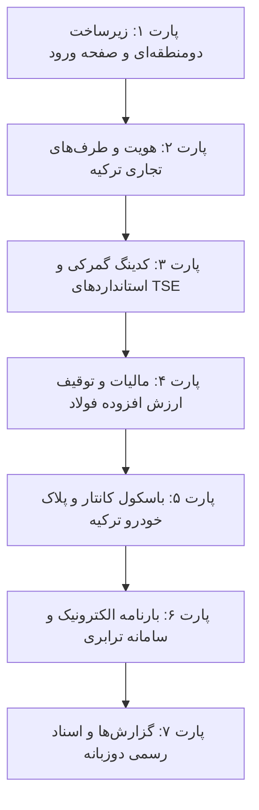

# 🇹🇷 نقشه راه تخصصی بومی‌سازی سامانه نکسوس‌پـور برای کشور ترکیه
# (NexusPour ERP - Türkiye Localization & Heavy WMS Master Roadmap)

> **سند استراتژیک، پارت‌بندی و چک‌لیست انطباق نرم‌افزار با استانداردها، قوانین مالیاتی، گمرکی و سامانه‌های دولتی ترکیه**  
> **صاحب امتیاز و مدیر محصول:** امید پورمحمود (Omid Pourmahmoud)  
> **نسخه سند:** 1.0.0  
> **وضعیت کلی:** در حال پیاده‌سازی فاز به فاز (بر اساس معماری تک‌کدبیس دو‌منطقه‌ای)

---

## 🎯 ۱. تحلیل نرم‌افزارهای پیشرو انبارداری و ERP ترکیه (Benchmarking)

در بررسی بازار نرم‌افزارهای صنعتی، لجستیک و صنف آهن‌آلات و فولاد ترکیه، ۳ سامانه اصلی بازار شامل **Logo Yazılım (Logo WMS & Tiger)**، **Mikro Yazılım (Mikro Fly)** و **Uyumsoft WMS** مورد تحلیل دقیق قرار گرفتند. امکانات استاندارد و حیاتی این نرم‌افزارها استخراج شده تا در نکسوس‌پـور به صورت کامل پیاده‌سازی شود:

### الف) اتصال به باسکول تریلی (Kantar Entegrasyonu)
* ثبت دو مرحله‌ای وزن خالی و پر تریلی در گیت ورود و خروج انبار.
* انطباق با حدود وزن ناخالص مجاز سازمان راهداری ترکیه (Karayolları Genel Müdürlüğü - KGM) تا ۴۰ الی ۴۴ تن ناخالص برای جلوگیری از جریمه‌های سنگین پلیس راه.
* صدور قبض باسکول رسمی ترکیه (Kantar Fişi) با بارکد دوبعدی (Karekod).

### ب) بارنامه الکترونیکی خروج (e-İrsaliye)
* در ترکیه برای جابجایی هر نوع بار فولادی، پتروشیمی یا تجاری، صدور حواله الکترونیکی قبل از خروج خودرو الزامی است.
* ثبت اطلاعات کامل راننده، شماره پلاک، شرکت حمل‌ونقل و بارنامه در ساختار درآمدی ترکیه (GİB).

### ج) سامانه الکترونیکی ردیابی وزارت ترابری (U-ETDS)
* ارسال اطلاعات سفر، مشخصات بار، وزن باسکول، پلاک تریلی و گواهینامه مهارت راننده (SRC) به سامانه وزارت ترابری و زیرساخت ترکیه (Ulaştırma ve Altyapı Bakanlığı).

### د) سیستم مالیات و توقیف مالیاتی آهن‌آلات (KDV & Demir-Çelik Tevkifatı)
* محاسبه نرخ‌های مالیات ارزش افزوده ترکیه (KDV) با نرخ‌های ۲۰٪، ۱۰٪ و ۱٪.
* اجرای قانون رسمی کسر مالیات آهن‌آلات (Tevkifat) با نسبت‌های قانونی (مانند ۴/۱۰ یا ۵/۱۰ یا ۷/۱۰) برای معاملات شمش، میلگرد، لوله و مقاطع فولادی.

### هـ) شناسه‌های هویتی رسمی ترکیه
* شناسه مالیاتی ۱۰ رقمی شرکت‌ها (Vergi Kimlik Numarası - VKN).
* کدملی ۱۱ رقمی اشخاص حقیقی و رانندگان (T.C. Kimlik No) با الگوریتم کنترلی ریاضی.
* شماره ثبت شرکت‌ها در اتاق بازرگانی (MERSİS No) و نام حوزه مالیاتی (Vergi Dairesi).

### و) کدینگ گمرکی و استانداردهای صنعتی
* کدهای ۱۲ رقمی تعرفه گمرکی بین‌المللی (GTİP) برای اظهار انبار و ترخیص گمرکی.
* استانداردهای رسمی کیفیت ترکیه (TSE) به ویژه TS 708 برای میلگردهای ساختمانی (B420B, B500B, B500C) و استانداردهای مقاطع ساختمانی (TS EN 10025).

---

## 🏗️ ۲. پارت‌بندی و فازهای اجرایی (Modular Execution Phases)

---

## 📋 ۳. شرح تفصیلی پارت‌ها و چک‌لیست کنترل پیشرفت

### 📦 پارت ۱: زیرساخت دو‌منطقه‌ای، چندزبانه و صفحه ورود (Core & Login Switcher)
- [x] **۱.۱** افزودن سوئیچ انتخاب کشور (ایران / ترکیه) در صفحه ورود (`templates/login.html`).
- [x] **۱.۲** موتور ترجمه دو زبانه (فارسی / ترکی استانبولی) با فایل‌های متنی استاندارد (`src/locales/fa.json` و `src/locales/tr.json`).
- [x] **۱.۳** ذخیره انتخاب کشور در کوکی و نشست کاربر (Session / Cookie) با روت اختصاصی `/set-region/{code}` و سوئیچر در نوار بالای هدر (`templates/base.html`).
- [x] **۱.۴** ماژول مدیریت ارز و نمایش لیر ترکیه (TL / ₺) در کنار ارزهای صادراتی (دلار / یورو).
- [x] **۱.۵** تنظیم تقویم میلادی استاندارد با فرمت روز/ماه/سال (`DD.MM.YYYY`) و فعال‌سازی جهت LTR در نسخه ترکیه بدون آسیب به نسخه ایران.

### 📦 پارت ۲: طرف‌های تجاری و شناسه‌های هویتی ترکیه (Business Partners)
- [x] **۲.۱** اعتبارسنجی ریاضی کد مالیاتی ۱۰ رقمی شرکت‌ها (VKN) مطابق الگوریتم رسمی سازمان مالیات ترکیه (GİB) در کلاینت و سرور.
- [x] **۲.۲** اعتبارسنجی الگوریتم رسمی ۱۱ رقمی کد ملی اشخاص (T.C. Kimlik No).
- [x] **۲.۳** افزودن فیلدهای شماره مرسیس (MERSİS No) و حوزه مالیاتی (Vergi Dairesi) به مدل‌های دیتابیس `Supplier` و `Customer`.
- [x] **۲.۴** امکان جستجو و فیلتر بر اساس نام شرکت، VKN و Vergi Dairesi در لیست و صفحات طرف‌های تجاری.
- [x] **۲.۵** ثبت خودکار شرکت‌های معتبر فولادی و ساختمانی ترکیه جهت نمایش به مشتریان ترک (Erdemir, İsdemir, Kardemir, Toros Gübre, Rönesans Holding, ENKA İnşaat, Marmara Çelik).

### 📦 پارت ۳: کدینگ کالا و استانداردهای صنعتی و گمرکی (Products & Standards)
- [x] **۳.۱** افزودن فیلد کد تعرفه گمرکی ۱۲ رقمی (GTİP) به جدول کالاها و فرم ثبت محصول.
- [x] **۳.۲** افزودن فیلد استانداردهای کیفیت ترکیه (TSE) و گریدهای ساختمانی (B420B, B500B, S235JR).
- [x] **۳.۳** تولید اتیکت و بارکد استاندارد کالا با فرمت استاندارد ترکیه و اصطلاحات ترکی.

### 📦 پارت ۴: موتور مالیات، عوارض و توقیف مالیات آهن‌آلات (Tax & Tevkifat)
- [x] **۴.۱** ماژول محاسبه خودکار مالیات بر ارزش افزوده (KDV) با نرخ‌های ۲۰٪، ۱۰٪ و ۱٪.
- [x] **۴.۲** ماژول تخصصی توقیف ارزش افزوده آهن و فولاد (Demir-Çelik KDV Tevkifatı) با تفکیک سهم فروشنده و خریدار.
- [x] **۴.۳** درج مبالغ پایه، مالیات کسر شده و مالیات قابل پرداخت در فاکتورها و رسیدها.

### 📦 پارت ۵: باسکول تریلی، ناوگان و پلاک خودرو ترکیه (Kantar & Transport)
- [ ] **۵.۱** طراحی ویجت پلاک اختصاصی ترکیه با کد استان و حروف استاندارد (مانند `34 ABC 123`).
- [ ] **۵.۲** کنترل اوزان مجاز راهداری ترکیه (KGM) با سقف ۴۰ تا ۴۴ تن ناخالص.
- [ ] **۵.۳** صدور قبض رسمی باسکول ترکیه (Kantar Fişi) به زبان ترکی با بارکد و امضای متصدی و راننده.

### 📦 پارت ۶: بارنامه الکترونیک و رهگیری ترابری (e-İrsaliye & U-ETDS)
- [ ] **۶.۱** صفحه صدور و مدیریت حواله الکترونیکی خروج انبار (e-İrsaliye) مطابق استانداردهای GİB.
- [ ] **۶.۲** تولید خروجی داده استاندارد جهت ارسال به سامانه رهگیری ناوگان وزارت ترابری (U-ETDS).
- [ ] **۶.۳** ثبت شماره بارنامه، شرکت باربری، اطلاعات راننده و کد گواهینامه مهارت (SRC).

### 📦 پارت ۷: اسناد رسمی و خروجی‌های مدیریتی دوزبانه (Reports & Documents)
- [ ] **۷.۱** صدور شناسنامه کیفیت ذوب (MTC) با استاندارد ترکی و لاتین برای خریداران صنعتی.
- [ ] **۷.۲** کاردکس مقداری و ریالی با اصطلاحات رسمی حسابداری انبار ترکیه (Giriş, Çıkış, Kalan).
- [ ] **۷.۳** خروجی استاندارد اکسل مطابق فرمت اظهار انبارداری گمرکات و اتاق‌های بازرگانی ترکیه.

---

## 📊 ۴. جدول لاگ وضعیت و پیشرفت اجرایی (Status Tracking Log)

| شماره پارت | عنوان پارت | وضعیت | فایل‌های کلیدی درگیر | تاریخ تکمیل |
| :---: | :--- | :---: | :--- | :---: |
| **پارت ۱** | زیرساخت دوگانه، چندزبانه و صفحه ورود | 🟢 تکمیل و فعال شده | `src/api/auth.py`, `src/core/localization/`, `templates/login.html`, `templates/base.html` | ۱۴۰۵/۰۷/۲۲ |
| **پارت ۲** | طرف‌های تجاری و شناسه‌های هویتی ترکیه | 🟢 تکمیل و فعال شده | `src/domain_model/inventory_models.py`, `src/api/parties_ui.py`, `templates/parties.html`, `scripts/test_part2.py` | ۱۴۰۵/۰۷/۲۲ |
| **پارت ۳** | کدینگ کالا و استانداردهای TSE و GTİP | 🟢 تکمیل و فعال شده | `src/domain_model/inventory_models.py`, `src/api/master_data_ui.py`, `templates/products.html`, `templates/barcode_label.html`, `scripts/test_part3.py` | ۱۴۰۵/۰۷/۲۲ |
| **پارت ۴** | مالیات KDV و توقیف مالیاتی آهن‌آلات | 🟢 تکمیل و فعال شده | `src/services/tax_service.py`, `src/domain_model/inventory_models.py`, `src/api/purchases_ui.py`, `templates/purchase_detail.html`, `scripts/test_part4.py` | ۱۴۰۵/۰۷/۲۲ |
| **پارت ۵** | باسکول تریلی و پلاک خودرو ترکیه | ⚪ در انتظار | `src/api/weighbridge_ui.py`, `templates/weighbridge.html` | - |
| **پارت ۶** | بارنامه e-İrsaliye و سامانه ترابری U-ETDS | ⚪ در انتظار | `src/api/compliance_ui.py`, `templates/compliance.html` | - |
| **پارت ۷** | گزارش‌ها و اسناد رسمی دوزبانه | ⚪ در انتظار | `templates/reports.html`, `templates/mtc_certificate.html` | - |

---

## 📌 قوانین تضمین کیفیت (QA & Development Rules)
1. **عدم شکست کدهای نسخه ایران:** کلیه تغییرات به صورت شرطی و بر اساس کشور فعال اعمال می‌شوند تا کارکرد نسخه ایران هیچ‌گونه تغییری نکند.
2. **اعتبارسنجی دوطرفه:** تمامی فیلدهای هویتی ترکیه هم در مرورگر (جاوااسکریپت) و هم در سرور (پایتون) با فرمول‌های ریاضی استاندارد اعتبارسنجی می‌شوند.
3. **پایداری داکر پروداکشن:** هر فیلد دیتابیس جدید با دستورات بدون داون‌تایم در `lifespan` اضافه خواهد شد.
